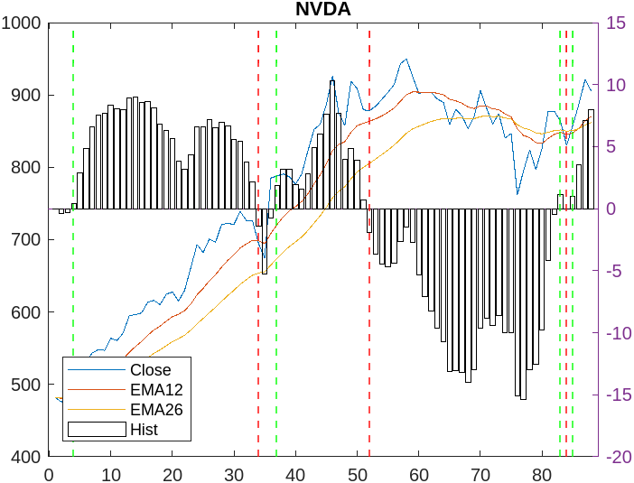

# Stock Picker Project
### A MATLAB trading strategy tested on historical NASDAQ-100 data

I built this project for my high school computer science final. It combines my interests in programming and applied math by using historical stock data to simulate trading decisions.

**Classroom result:** My strategy earned first place in our class programming competition, which compared the returns produced by each student's algorithm over the assigned historical period.

## What it does

Starting with a simulated **$10,000 budget**, the program analyzes historical NASDAQ-100 stock data to determine when to buy or sell and how many shares to trade.

The project brings together:

- **Data processing:** Importing stock lists and transaction records into MATLAB tables.
- **Trading logic:** Using loops, arrays, and conditional statements to make decisions within a budget.
- **Applied math:** Calculating exponential moving averages to help identify changes in price trends.
- **Results:** Recording transactions and visualizing the simulation's performance.

## Example output

*An example chart from the original classroom run.*

## Explore the project

| File | Purpose |
| --- | --- |
| [`RunStockTool.m`](RunStockTool.m) | Main script for running the trading simulation. |
| [`calcEMA.m`](calcEMA.m) | Calculates exponential moving averages used by the strategy. |
| [`processTransactions.m`](processTransactions.m) | Processes transaction records. |
| [`createTransactionTable.m`](createTransactionTable.m) | Organizes transaction data into MATLAB tables. |
| [`NASDAQ100.txt`](NASDAQ100.txt) | List of stocks used by the algorithm. |
| [`StockPickerProject.mlx`](StockPickerProject.mlx) | MATLAB live script included with the project. |
| [`StockPickerProject.pdf`](StockPickerProject.pdf) | PDF version of the project. |

## Current status

> **Compatibility note:** The project ran successfully during the classroom competition. The external `tickers` function currently throws an error in the newer MATLAB Online environment.

The source code and saved output remain available to explore. Running the full simulation may require resolving that compatibility issue first.

## What I learned

This project gave me practice turning a mathematical idea into a working program: importing data, writing decision rules, tracking a changing budget, and organizing the results so I could understand what the algorithm had done.

The first-place result reflects performance in our classroom simulation over a specific historical period. It does not establish how the strategy would perform on new data or in live trading.

